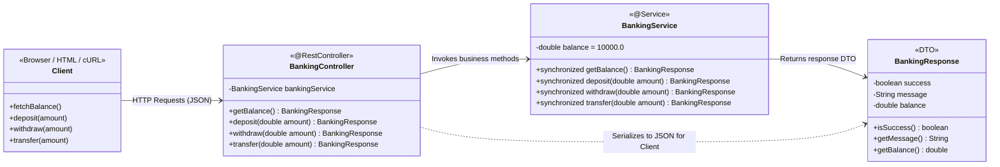

# Online Banking System - System Design SAT LLD Practical Demo

A lightweight, beginner-friendly Online Banking System built with **Java 17**, **Spring Boot 3**, and **Maven**. Designed specifically for System Design / Low-Level Design (LLD) practical demonstrations.

---

## 🏛️ System Architecture & LLD Class Diagram

The application adheres to a clean layered architecture demonstrating separation of concerns:
**Client (Browser / REST Client) ➔ Controller Layer ➔ Service / Business Logic Layer (In-Memory State)**



---

## ⚙️ Features & Business Rules

1. **Initial Balance:** Starts at ₹10,000 in-memory (no database required).
2. **Thread Safety:** Service methods use synchronization to ensure atomic account balance mutations.
3. **Validation & Guardrails:**
   - Amounts $\le 0$ are rejected with an error message.
   - Withdrawals exceeding the current balance are rejected.
   - Transfers exceeding the current balance are rejected.
4. **Single Controller:** Handled concisely in `BankingController.java`.
5. **Interactive Frontend:** Built-in web UI served directly at `http://localhost:8080/`.

---

## 🚀 Running the Application

### Prerequisites
- **Java 17+**
- **Maven 3.8+** (or use standard Maven CLI)

### Terminal Command
In the project root directory, run:

```bash
mvn spring-boot:run
```

Once started, open your web browser at:
👉 **[http://localhost:8080/](http://localhost:8080/)**

---

## 📡 REST API Documentation

### 1. Get Current Balance
- **Method:** `GET`
- **URL:** `http://localhost:8080/api/balance`
- **Sample Response:**
```json
{
  "success": true,
  "message": "Current balance fetched successfully.",
  "balance": 10000.0
}
```

---

### 2. Deposit Money
- **Method:** `POST`
- **URL:** `http://localhost:8080/api/deposit?amount=1000`
- **Sample Success Response:**
```json
{
  "success": true,
  "message": "Deposit of ₹1000.0 successful.",
  "balance": 11000.0
}
```
- **Sample Validation Failure (`amount <= 0`):**
```json
{
  "success": false,
  "message": "Deposit failed: Amount must be greater than zero.",
  "balance": 10000.0
}
```

---

### 3. Withdraw Money
- **Method:** `POST`
- **URL:** `http://localhost:8080/api/withdraw?amount=500`
- **Sample Success Response:**
```json
{
  "success": true,
  "message": "Withdrawal of ₹500.0 successful.",
  "balance": 10500.0
}
```
- **Sample Insufficient Balance Failure:**
```json
{
  "success": false,
  "message": "Withdrawal failed: Insufficient balance. Available: ₹10500.0",
  "balance": 10500.0
}
```

---

### 4. Simulate Transfer
- **Method:** `POST`
- **URL:** `http://localhost:8080/api/transfer?amount=200`
- **Sample Success Response:**
```json
{
  "success": true,
  "message": "Transfer of ₹200.0 simulated and completed successfully.",
  "balance": 10300.0
}
```

---

## 🧪 Testing with cURL / PowerShell

```bash
# Check initial balance
curl -X GET "http://localhost:8080/api/balance"

# Deposit 1000
curl -X POST "http://localhost:8080/api/deposit?amount=1000"

# Withdraw 500
curl -X POST "http://localhost:8080/api/withdraw?amount=500"

# Transfer 200
curl -X POST "http://localhost:8080/api/transfer?amount=200"

# Test rejection (amount <= 0)
curl -X POST "http://localhost:8080/api/withdraw?amount=-50"

# Test rejection (exceeding balance)
curl -X POST "http://localhost:8080/api/withdraw?amount=999999"
```
